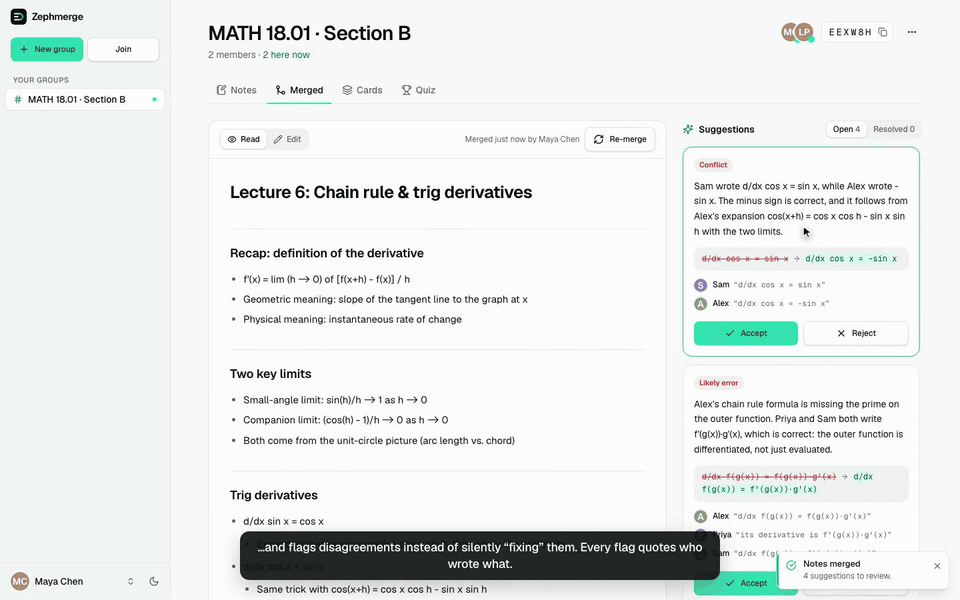

# Zephmerge

A shared study notebook for a class group. Everyone adds their own lecture notes. The AI merges them into one study sheet and **proposes** corrections, each quoting the notes it came from, for the group to accept or reject. The group then studies together with flashcards and a live quiz.

**Live:** https://zephmerge.app.space · **Full demo video (1:51):** [demo/media/zephmerge-demo.mp4](demo/media/zephmerge-demo.mp4)

[](demo/media/zephmerge-demo.mp4)

---

## Try it

**Alone (about 2 minutes):**
1. Sign in, click **New group**, and give it a name.
2. In **Notes**, click **Try with demo notes**. This adds three classmates' notes on MIT OCW 18.01 (chain rule and trig derivatives) with [planted mistakes](demo/README.md).
3. Open **Merged** and click **Merge notes** (about 20–40 s). Check each suggestion's quotes against the notes, then accept or reject.
4. Open **Cards** and click **Make flashcards**, then **Study now** (Space flips the card; 1 = missed, 2 = got it).

**With others (the real use):** open a second browser or an incognito window and sign in as someone else. Join with the 6-character code from the group header. Notes, the merged sheet, suggestions and the quiz all update live. Start a **Quiz** with one person as host.

The demo notes are also plain files in [`demo/`](demo/) if you'd rather upload them by hand.

## How it works

| Need | DeepSpace primitive | Where |
|---|---|---|
| Sign-in, gated pages | Auth (`AuthGate`, `(protected)` routes) | `src/pages/(app)/(protected)/` |
| Groups isolated from each other | Records + **team permissions** (`teamField` + `team_members`) | `src/schemas/groups-schema.ts` |
| Notes, suggestions, cards, quiz | Records via **server actions** (all writes are membership-checked) | `src/actions/` |
| Merged notes everyone edits live | **Yjs** text bound to the group record (`useYjsText`) | `src/components/merged/` |
| AI merge, flashcards | **Worker AI** (`createDeepSpaceAI`, Anthropic via the DeepSpace proxy) | `src/server/ai.ts`, `src/server/prompts.ts` |
| Who's here / who's editing / who answered | **Presence rooms** (`usePresenceRoom`) | group header, Merged, Quiz |
| Personal study progress | Records with `userBound` + `'own'` permissions (Leitner boxes) | `src/lib/leitner.ts` |

**Data model:** `groups`, `team_members`, `notes`, `suggestions`, `cards`, `card_progress` (per user), `quiz_sessions`, `quiz_keys` (server-only), `quiz_answers` (server-only), `ai_usage`, `join_attempts`.

### The main trade-off: the AI proposes, people decide
Auto-correcting the merged notes would look more magical. But an AI quietly rewriting people's notes destroys trust the first time it's wrong, and in study material a confident wrong "fix" is worse than no fix. So every correction is a suggestion with its evidence quoted, at the cost of one click each.

The output is also **verified before anything is written** (`src/lib/mergeValidate.ts`, 16 unit tests):
- a suggestion is dropped unless its target text appears **exactly once** in the merged notes, so a patch can never land in the wrong place;
- each quote is dropped unless it really appears in that member's note, which catches the most common hallucination: invented evidence.

Flashcards get the same treatment. Each card must quote the merged notes, and its three wrong answers must differ from the right answer and from each other.

On the demo notes the merge caught all three planted mistakes, and the checks dropped nothing as fabricated (log in the write-up).

### Other decisions
- **Server action, not a background job, for merging:** a measured merge takes about 22 s, comfortably inside one request.
- **Plain-text markdown for the merged notes, not a rich-text editor:** a suggestion is an exact text patch, which stays reliable on plain text.
- **One record scope with team permissions** rather than a room per group: it's the documented pattern, and it keeps "my groups" a single query.

## DeepSpace integrations, and what's left out

**Used:** worker AI (merge, flashcards), real-time records with team permissions, Yjs collaborative text, presence rooms, auth.

**Left out on purpose:**
- **Knowledge / RAG:** one lecture's notes fit in a single prompt.
- **PDF ingest:** reliable extraction is its own project; plain text and markdown keep the core path solid.
- **Email recap and the canvas concept map:** cut for time (see Next).
- **Payments, LiveKit, OAuth scopes:** no user need.

## Security and cost guardrails

- **Every write is checked on the server.** Actions run with permissions bypassed, so each one checks membership itself (`assertMember`) and scopes every query by group. Clients can't create rows in a group they don't belong to.
- **Outsiders see nothing.** Permissions live in the schemas, and the Playwright tests prove a non-member can't read a group's notes or write into it. That includes the app owner's admin account, whose reads are also limited to groups it belongs to.
- **The quiz can't be cheated from the browser:**
  - the answer key is stored where members can't read it, and each answer is published only at reveal;
  - deadlines are checked against the server clock;
  - one answer per question is enforced by the database;
  - only the host can advance;
  - all of this is tested.
- **AI cost:** AI runs only inside signed-in server actions, with a cap of 25 AI actions per user per day, a 2-minute merge cooldown per group, and input limits (15k characters per note, 60k per merge).
- **Prompt injection:** notes are treated as untrusted data in prompts, and every AI output is schema-checked before it's written.
- **Privacy:** emails are never shown to teammates. Display names are copied server-side.
- **No secrets in the repo:** all provider calls go through the DeepSpace proxy.

## Run it locally

```sh
npm install
npx deepspace auth login
npx deepspace dev start        # http://localhost:5173
npm run test:unit              # 66 unit tests (validation, scoring, Leitner, join codes, schema lint)
npx deepspace test run e2e     # Playwright: needs 3 test accounts (npx deepspace test accounts create …)
```

The e2e suite covers create/join/leave, live notes, outsider lockout, a real AI merge with quote verification, accept/reject, live editing, flashcards, and the quiz anti-cheat rules. The AI specs make real (owner-billed) model calls.

## Known limitations and next steps

**Limitations:**
- **Presence names:** presence rooms aren't membership-checked by the scaffold route. A non-member who knew a group's UUID could see who's online there (names only, no data).
- **Re-merge and live typing:** re-merging replaces the whole merged document, so a keystroke made during that instant can be lost.
- **A second tab after leaving:** if you leave a group while another tab of yours is open, that tab may keep getting live updates until it reconnects. Actions are still refused.

**Next:**
- weak-spot quiz weighting (questions skewed toward cards the group misses);
- an email recap after a quiz;
- an AI concept map on a shared canvas;
- photo-of-handwritten-notes and PDF ingest;
- "ask the notebook" chat;
- a daily review reminder.
